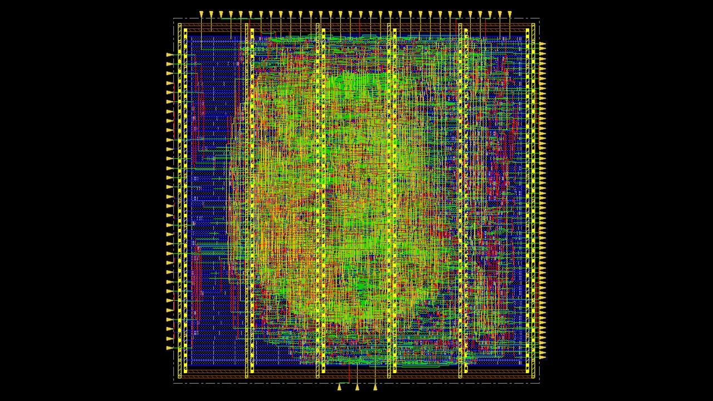
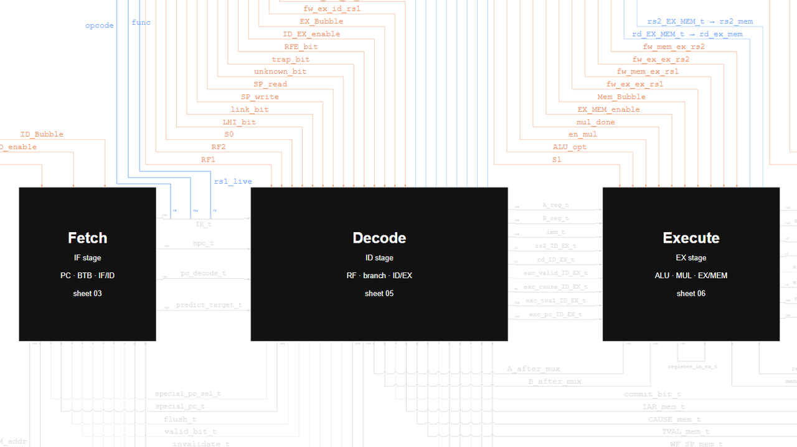
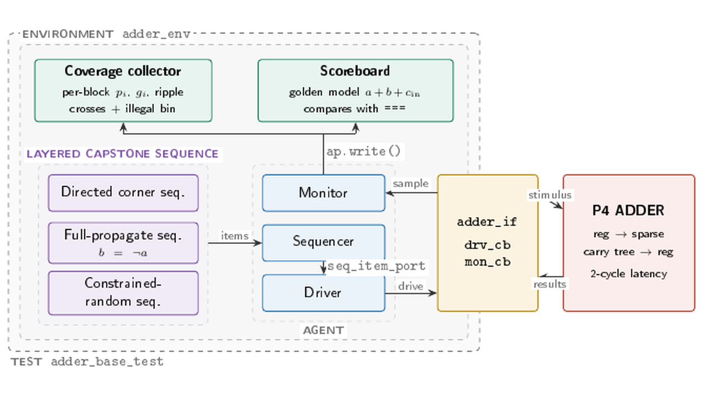
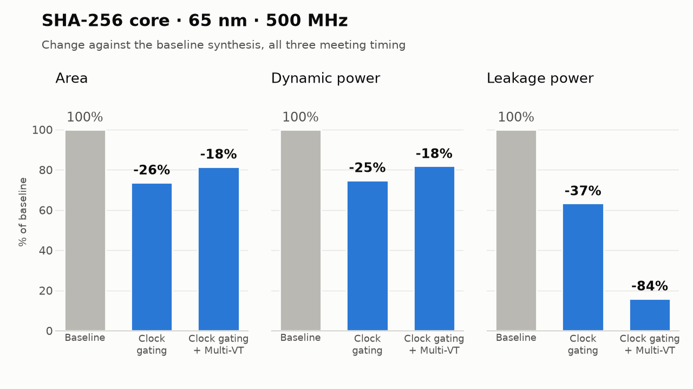
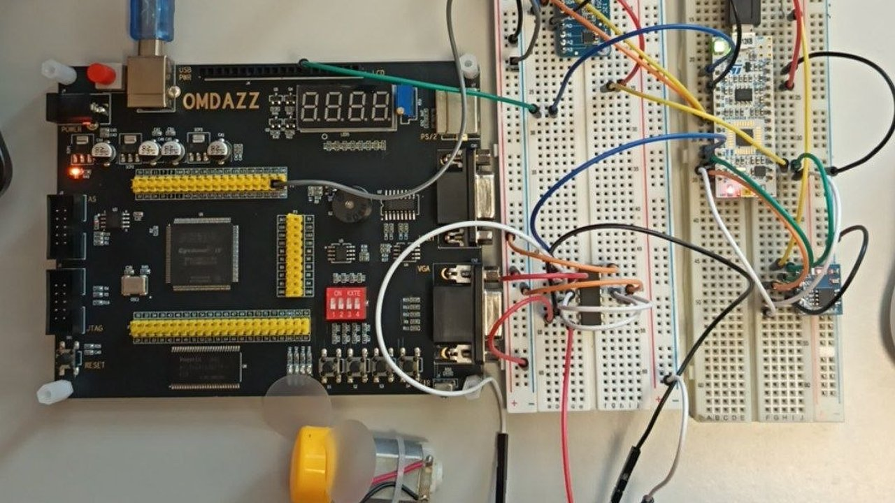
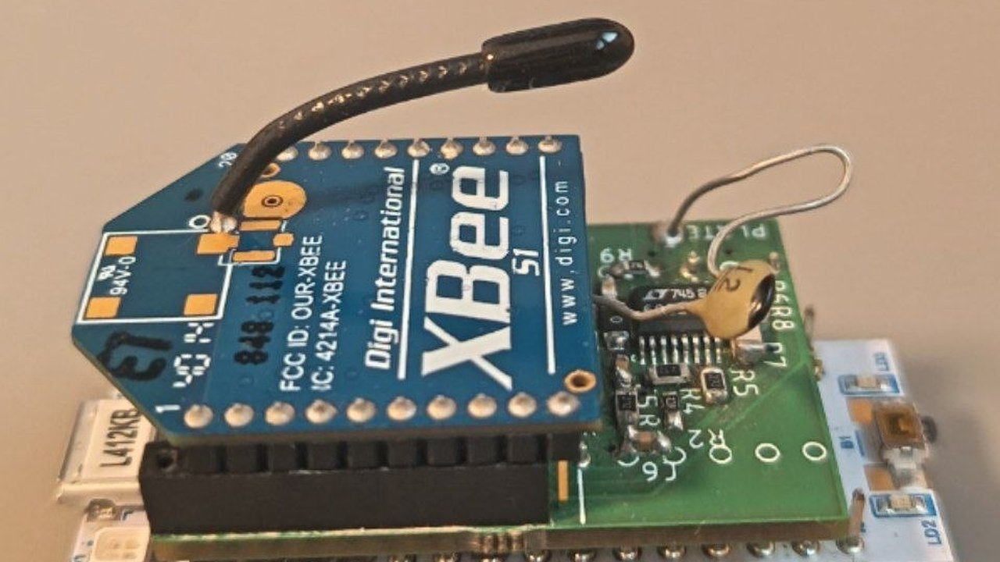

<h1 align="center">Erfan Taheri</h1>

Digital Design &amp; Verification Engineer · MSc Computer Engineering (Embedded Systems), Politecnico di Torino 
<a href="https://www.linkedin.com/in/erfan-taheri-t1/">LinkedIn</a> · <a href="mailto:Erfan.Taheri@studenti.polito.it">Email</a> 
<i>What stands in the way, becomes the way</i>

## About

I work on RTL implementation of arithmetic and processor datapaths, functional verification in SystemVerilog/UVM, and taking designs through synthesis, static timing and place-and-route while measuring area, timing and power. My approach is systematic: I build several optimized versions of a design, measure each under the same constraints, and compare them by exploring the design space and plotting the Pareto front.

On the verification side I write SystemVerilog/UVM testbenches with reference-model scoreboards, functional coverage and RAL, and reuse them on the synthesized netlist. Code coverage on the windowed register file is what exposed a bug in its window-overflow logic.

I also write embedded firmware: bare-metal STM32 code at register level without HAL, a four-node wireless sensor network, and FPGA logic that sends commands to the microcontroller.

I'm based in Turin and looking for internships and junior positions in FPGA and ASIC design and verification, available from February 2027.

## Featured projects

<table>
<tr>
<td width="50%" valign="top">
 
<b><a href="https://github.com/Erfan-TT/radix4-booth-multiplier">Radix-4 Booth Multiplier</a></b> 
Signed 32×32 multiplier in structural VHDL on Nangate45 (45 nm), refined from behavioural Booth through Wallace and Dadda trees to a fused selector. Every version synthesized, placed, routed and compared with Design Compiler's own <code>A * B</code> reference. 
<b>19% smaller, 13% faster, 21% more energy-efficient than the behavioural start; within 0.02 ns of DesignWare latency after layout (1.51 vs 1.49 ns).</b> 
VHDL · Synopsys Design Compiler · Cadence Innovus
</td>
<td width="50%" valign="top">
 
<b><a href="https://github.com/Erfan-TT/my-cpu-results">5-Stage Pipelined DLX Processor</a></b> 
32-bit DLX CPU in VHDL with branch prediction, forwarding, a pipelined Booth/Dadda multiplier, sub-word memory operations and exceptions. Eight RTL revisions (V0–V7) studied for clock period: 336 Design Compiler runs, every netlist verified at gate level with 24 assembly programs. 
<b>Fastest version closes at 1.41 ns (709 MHz).</b> 
VHDL · Synopsys Design Compiler · Python
</td>
</tr>
<tr>
<td width="50%" valign="top">
 
<b><a href="https://github.com/Erfan-TT/uvm-results">UVM Verification</a></b> 
SystemVerilog/UVM environments for a registered 32-bit P4 (parallel-prefix) adder and a 64-bit windowed register file, with architecture-aware functional coverage, a RAL backdoor model, and reuse on the post-synthesis netlist. 
<b>100% functional coverage on both (117/117 and 69/69 bins); code coverage exposed a window-overflow defect in the register file.</b> 
SystemVerilog · UVM · RAL · Questa
</td>
<td width="50%" valign="top">
 
<b><a href="https://github.com/Erfan-TT/sha256-synthesis-optimization">SHA-256 Synthesis &amp; Power Optimization</a></b> 
Baseline vs clock gating vs clock gating + Multi-VT on a 65 nm library at 500 MHz. The RTL is the open-source Secworks core; the flow, constraints, optimization configurations and PPA analysis are my work. 
<b>Clock gating cut area by 26% and dynamic power by 25%; Multi-VT cut leakage by 84% against baseline, all at timing closure.</b> 
Synopsys Design Compiler · PrimeTime · TCL
</td>
</tr>
<tr>
<td width="50%" valign="top">
 
<b><a href="https://github.com/Erfan-TT/register-level-light-controlled-fan">Light-Controlled Fan, Register-Level STM32 + FPGA</a></b> 
Bare-metal STM32L4 firmware with its own clock, GPIO, USART, SPI, I²C and timer drivers. A 16-bit I²C ADC reads a photoresistor and sets a 20 kHz PWM motor stage; samples are logged to SPI flash with CRC-checked records. A VHDL UART on a Cyclone IV FPGA is the command interface. 
<b>No HAL: every peripheral configured through its registers.</b> 
C (bare-metal) · VHDL · STM32L4 · Cyclone IV
</td>
<td width="50%" valign="top">
 
<b><a href="https://github.com/Erfan-TT/Capacitive_Sensor_Sync">Capacitive Sensor Sync</a></b> 
BSc final project (supervisor: Prof. M. T. Lazarescu). A 4-node wireless capacitive sensor network for presence detection: STM32L412KB nodes with XBee 802.15.4 radios and a MATLAB coordinator that broadcasts one request, with time-slotted replies to avoid collisions. 
<b>Synchronized 4-node readings, with drift cancellation (IEEE Sensors Journal, 2022) computed on each node.</b> 
C (bare-metal) · STM32 · XBee · MATLAB
</td>
</tr>
</table>

## More projects

- [Montgomery Serial Multiplier](https://github.com/Erfan-TT/montgomery-serial-multiplier): bit-serial modular multiplier in VHDL (FSMD), comparing behavioural and structural P4-adder datapaths. In progress.
- [VHDL Digital Design](https://github.com/Erfan-TT/VHDL-Digital-Design): FPGA lab designs on the DE1-SoC: adders, multipliers, counters, FSMs.
- [MATLAB Signal Processing](https://github.com/Erfan-TT/MATLAB-signal-processing): communication-system simulation with notch and Bessel filtering and AM multiplexing; up to 37.6 dB SIR.

## Toolbox

<table>
<tr><td><b>HDL</b></td><td>VHDL, SystemVerilog, Verilog</td><td><b>Low power</b></td><td>Clock gating, Multi-VT, activity-based power</td></tr>
<tr><td><b>Verification</b></td><td>UVM, SVA, constrained-random, coverage</td><td><b>Embedded</b></td><td>Bare-metal C, STM32, register-level drivers</td></tr>
<tr><td><b>Synthesis &amp; STA</b></td><td>Synopsys Design Compiler, PrimeTime</td><td><b>Simulation</b></td><td>QuestaSim/ModelSim, GHDL</td></tr>
<tr><td><b>Physical design</b></td><td>Cadence Innovus</td><td><b>Scripting</b></td><td>TCL, Python, Bash</td></tr>
</table>
